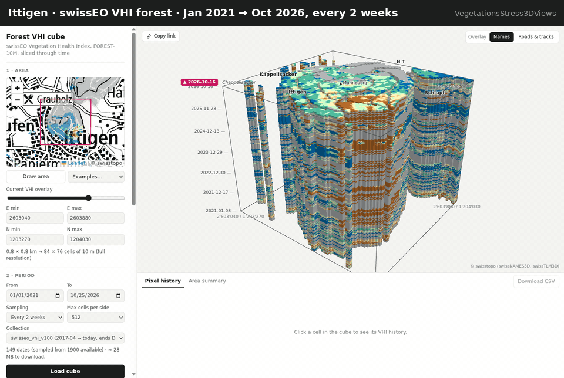

# Vegetation Stress 3D Views

> **Experimental.** This is a prototype for exploring how forest condition develops over time. It is not an official swisstopo product, and it is not validated for operational use.

**Live demo:** https://davidoesch.github.io/VegetationsStress3DViews/



*Ittigen, January 2021 to October 2026, sampled every two weeks. [Open this view live](https://davidoesch.github.io/VegetationsStress3DViews/#c=v100&from=2021-01-01&to=2026-10-25&step=2week&px=512&bbox=2603040,1203270,2603880,1204030&h=0.8&pin=67,58).*

Pick any forest area in Switzerland and a period. The page stacks the daily swissEO **Vegetation Health Index (VHI)** maps of that area into a space–time cube that you can rotate, slice and filter:

- **east × north × time:** the oldest date is at the bottom and the newest at the top; non-forest cells are empty;
- **slice:** crop the cube along each axis, or move the top face through time (▶ Play);
- **filter:** hide VHI classes, e.g. "Stress only (< 40)", to see the 3D shape of stress events;
- **pixel history:** click any cell to get its VHI time series, and jump the cube to any date from the chart;
- **area summary:** the share of forest cells in each class, per date;
- **orientation overlay:** place, area and forest names, plus roads and forest tracks, on the top face (toggle at the top right of the cube);
- **share:** the URL keeps the area, period, cut, filter, overlay and pinned cell; **Copy link** (top left of the cube) puts that link on the clipboard, so others open the same view.

The viewer starts with the period 1 April – 31 October 2026.

**Examples** (weekly, April–October 2025):
[La Neuville](https://davidoesch.github.io/VegetationsStress3DViews/#c=v100&from=2025-04-01&to=2025-10-31&step=week&px=512&bbox=2570570,1212120,2573150,1214400) ·
[Ittigen](https://davidoesch.github.io/VegetationsStress3DViews/#c=v100&from=2025-04-01&to=2025-10-31&step=week&px=512&bbox=2603040,1203270,2603880,1204030&ov=names,roads) ·
[Pfynwald](https://davidoesch.github.io/VegetationsStress3DViews/#c=v100&from=2025-06-01&to=2025-08-31&step=week&px=512&bbox=2610200,1125800,2615200,1128800)

## Inspiration and sources

- **Idea:** the space–time cube in [*Zarr SQL views*](https://gjoremilevski.com/posts/zarr-sql-views/) by Gjore Milevski. There, Zarr chunks are loaded in the browser, queried with DuckDB-WASM and drawn as a deck.gl volume. This project applies the same "slice a data cube in the browser" idea to Cloud Optimized GeoTIFFs.
- **Data:** [swissEO VHI](https://www.swisstopo.admin.ch/en/satelliteimage-swisseo-vhi) by swisstopo, developed with MeteoSwiss for the federal drought portal. It is accessed through the STAC API at [data.geo.admin.ch](https://data.geo.admin.ch/api/stac/v1/collections/ch.swisstopo.swisseo_vhi_v100), using the asset **FOREST-10M** in EPSG:2056 (LV95). Contains modified Copernicus Sentinel data.
- **Overlay:**
  - names come from swisstopo [swissNAMES3D](https://www.swisstopo.admin.ch/en/landscape-model-swissnames3d), via the geo.admin.ch identify API;
  - roads and tracks come from [swissTLM3D](https://www.swisstopo.admin.ch/en/landscape-model-swisstlm3d), via the geo.admin.ch WMS.

  Both are requested in LV95, so they line up exactly with the VHI grid. The swisstopo [base map vector tiles](https://www.swisstopo.admin.ch/en/web-maps-imagery-base-map) are only published in Web Mercator. At the edges of Switzerland that is rotated by up to about 2° against LV95, which would shift labels by tens of metres.

## Data notes

| Value | Class | Colour |
|---|---|---|
| 0–9 | Extremely stressed | `#b56a29` |
| 10–19 | Very stressed | `#ce8540` |
| 20–29 | Stressed | `#f5cd85` |
| 30–39 | Slightly stressed | `#fff5ba` |
| 40–49 | Normal | `#cbffca` |
| 50–59 | Good | `#52bd9f` |
| 60–100 | Excellent | `#0470b0` |
| 110 | Missing data (e.g. clouds, snow) | `#b3b6b7` |
| 255 | No data / not forest | not drawn |

- **Coverage:** FOREST-10M exists from **2017-04-03** onwards, as daily composites of the last seven days, with gaps. Earlier VHI data, monthly at 30 m, is not used here.
- **Collections:** `ch.swisstopo.swisseo_vhi_v100` is announced to be **disabled after December 2026**. The page can also read the successor `ch.swisstopo.swisseo_vhi_v200`, which only starts in October 2026.
- **Aggregation:** for areas up to roughly 20 × 20 km the page reads the full 10 m data. When the cube needs coarser cells, it averages the valid 10 m pixels itself. Larger areas fall back to the COG overviews. swisstopo built those overviews by averaging, which can mix "missing" (110) into VHI values, so the page warns when it uses them.
- **Time axis:** each loaded date is one equally thick layer, so gaps between dates are not to scale. The pixel chart uses a true date axis.

## How it works

The site is plain HTML and JavaScript ES modules, with no build step and no backend. Everything happens in the browser:

1. **Find dates:** the STAC API lists the dates in the chosen period, sampled weekly, every two weeks or monthly.
2. **Read data:** [geotiff.js](https://geotiffjs.github.io/) reads only the needed 512 × 512 tiles of each COG via HTTP range requests (data.geo.admin.ch allows cross-origin requests).
3. **Build the cube:** the tiles are stacked into a byte volume, which is uploaded to the GPU as a 3D texture.
4. **Draw it:** a [three.js](https://threejs.org/) shader walks each view ray through the voxels and draws the first visible one. Cropping and class filtering are simply parameters of that shader. Hover and click use the same traversal in JavaScript.
5. **Overlay:** names are HTML labels that always face the viewer and are thinned so they don't overlap; zooming in reveals more. Roads are an image laid on the top face.
6. **Area picker:** a [Leaflet](https://leafletjs.com/) map with the swisstopo grey map and the swissTLM3D forest layer, to show where the forest is; [proj4js](https://proj4js.org/) converts coordinates to LV95.

| File | Purpose |
|---|---|
| `index.html` | Layout, styles, CDN import map |
| `js/main.js` | UI wiring: map, controls, URL state, tooltips |
| `js/stac.js` | STAC queries and date sampling |
| `js/loader.js` | COG window reads, aggregation, volume building |
| `js/cube.js` | three.js voxel ray-marcher, slicing, picking |
| `js/chart.js` | Pixel-history and area-summary charts (SVG) |
| `js/overlay.js` | swissNAMES3D labels and swissTLM3D roads for the top face |
| `js/classes.js` | VHI classes, colours, lookup table |

## Next step: GeoZarr instead of one COG per day

Reading the raw COGs works, but it is the slow part of this prototype. The archive is laid out as one file per day: each COG covers all of Switzerland, about 120 MB, chunked only in space into 512 × 512 tiles. A space–time cube cuts across that layout:

- **One header per date.** Each date needs its own header read (about 64 KB) before any pixel arrives.
- **Whole tiles for small windows.** A small area still costs whole 512 × 512 tiles for every date.
- **Time is the expensive axis.** A pixel's history needs one tile per date.

**Measured** for the Pfynwald example (5 × 3 km, 14 weekly dates): **42 range requests and 7.9 MB transferred** for 2.1 million cells, about 2.1 MB of actual values. **Estimated** for one pixel over a year of daily data: about 330 header reads plus 330 tile reads, roughly 60 MB, to obtain 330 bytes.

A [GeoZarr](https://github.com/zarr-developers/geozarr-spec) cube of the same data would make this much faster:

- **One store** with the dimensions `time × y × x`. Chunks span time as well as space, e.g. 64 dates × 256 × 256 pixels, so one request returns weeks of data for a whole forest patch.
- **Metadata read once** (consolidated `zarr.json`), instead of a header per file.
- **Zarr v3 sharding** packs many small chunks into a few large objects. These are still read with HTTP range requests, just like COGs, and stay easy to host on object storage.
- **Multiscales:** overviews built with a VHI-aware rule (mean of valid values, ignoring 110 and 255) instead of averaging class codes.
- **Same browser stack as the inspiration post:** [zarrita.js](https://github.com/manzt/zarrita.js) to read chunks, and optionally DuckDB-WASM for SQL filters such as "VHI < 20 for three consecutive weeks".

This needs a conversion pipeline (e.g. Python with xarray, rioxarray and zarr) that turns the COG archive into a GeoZarr store and appends each new day, hosted with CORS enabled. Ideally swisstopo would publish the cube next to the COGs. GeoZarr is still being standardised in the OGC GeoZarr Standards Working Group, so the conventions may change.

## Run locally

Serve the folder with any static web server, for example:

```bash
python3 -m http.server 8000
# open http://localhost:8000
```

A browser with WebGL 2 is required.

## Deployment

Every push to `main` publishes the site to GitHub Pages via [`.github/workflows/pages.yml`](.github/workflows/pages.yml).

## Feedback

This is an experiment, so feedback is very welcome: [open an issue](https://github.com/davidoesch/VegetationsStress3DViews/issues/new) with ideas, questions or bugs. The page footer links here too.

## License

Code: [Apache 2.0](LICENSE). The VHI data remains subject to swisstopo's terms of use.
